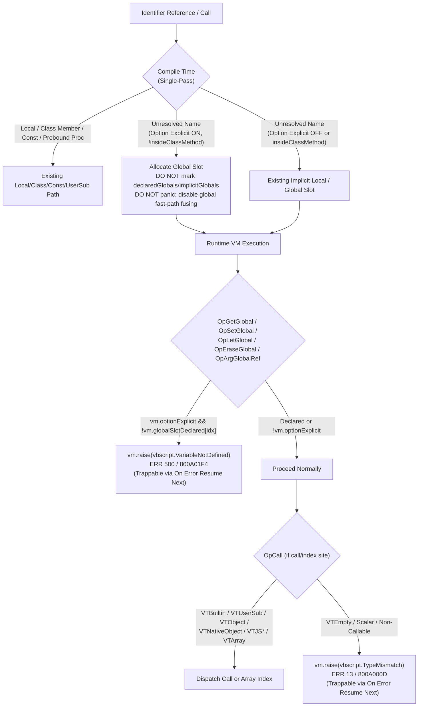

# Known Issues & Architectural Plan: Undefined Procedure Calls and Runtime `Option Explicit` Validation

## Bug Summary & IIS 10.0 Target Parity Specification

In AxonASP (v2.3.38 / current `main`), calling a non-existent `Function` or `Sub` raises no error, and `Option Explicit` variable validation diverges from IIS:
- `x = NoSuchFunction()` sets `x` to `Empty` and continues.
- `Call NoSuchSub` / `NoSuchSub` / `NoSuchSub 1` do nothing.
- Under `Option Explicit`, reading an undeclared variable (`x = NoSuchVar`, `x = NoSuchVar + 1`) silently evaluates to `Empty`.
- Under `Option Explicit`, assigning to an undeclared variable currently raises a **compile-time** `800A01F4` that aborts the entire page, whereas IIS raises a **trappable runtime error** at the specific statement.

### Target Parity Matrix (Measured on IIS 10.0 under `On Error Resume Next`)

| Statement | IIS (No `Option Explicit`) | IIS (`Option Explicit`) | Current AxonASP (Both) |
| :--- | :--- | :--- | :--- |
| `x = NoSuchFunction()` | Runtime `ERR 13` (`800A000D` Type mismatch) | Runtime `ERR 500` (`800A01F4` Variable is undefined) | No error, `x = Empty` |
| `x = NoSuchFunction(1, 2)` | Runtime `ERR 13` | Runtime `ERR 500` | No error, `x = Empty` |
| `Call NoSuchSub` | Runtime `ERR 13` | Runtime `ERR 500` | No error |
| `Call NoSuchSub(1)` | Runtime `ERR 13` | Runtime `ERR 500` | No error |
| `NoSuchSub` | Runtime `ERR 13` | Runtime `ERR 500` | No error |
| `NoSuchSub 1` | Runtime `ERR 13` | Runtime `ERR 500` | No error |
| `x = NoSuchVar` (no parens) | No error, `Empty` (matches) | Runtime `ERR 500` | No error, `x = Empty` |
| `x = NoSuchVar + 1` | No error, `1` | Runtime `ERR 500` | No error, `x = 1` |

*Note: Errors must be trappable via `On Error Resume Next` at runtime (populating `Err.Number` / HRESULT) and halt execution with HTTP 500 when uncaught.*

---

## 1. Current State Audit

### 1.1 Compilation & Execution Pipeline by Construct

| Construct | Compiler Entry Point | Emitted Bytecode | VM Execution Path | Current Defect |
| :--- | :--- | :--- | :--- | :--- |
| `x = Foo()` / `x = Foo(1, 2)` | `axonvm/compiler_expr.go` (L55-L187 `emitIdentifierValue`, L986-L1035 `PunctLParen` infix) | `OpGetGlobal <idx>`, args, `OpCall <argc>`, `OpCoerceToValue` | `axonvm/vm.go` (L4451-L4559 `case OpCall:`) | `OpCall` `else` branch (L4557-L4559) pushes `VTEmpty` when `target` is `VTEmpty`/non-callable; no error raised. |
| `Call Foo` (no parens) | `axonvm/compiler_stmt_parser.go` (L359-L363 `KeywordCall`) | `OpGetGlobal <idx>` (or StaticObjects fallback block), `OpCoerceToValue`, `OpPop` | `OpGetGlobal` -> `OpCoerceToValue` -> `OpPop` | **`OpCall` is never emitted.** `OpCoerceToValue` only auto-invokes 0-arg `Function`s (`v.UserSubIsFunc()`), not `Sub`s or undefined names. Silent no-op. |
| `Call Foo(1)` | `axonvm/compiler_stmt_parser.go` (L359-L363) -> `parseExpression` | `OpGetGlobal <idx>`, `OpConstant 1`, `OpCall 1`, `OpCoerceToValue`, `OpPop` | `case OpCall:` | Same `OpCall` `else` branch silently pushes `VTEmpty`. |
| `Foo` (bare 0-arg stmt) | `axonvm/compiler_stmt_parser.go` (L852-L937) | `OpGetGlobal`/`OpGetLocal <idx>`, `OpCall 0` (only if `isKnownZeroArgSub \|\| !isKnownDeclaredVariable`), `OpPop` | `case OpCall:` | `OpCall` `else` pushes `VTEmpty`. Also skips `OpCall 0` when identifier is a declared non-callable variable (`Dim x : x`). |
| `Foo 1` (bare stmt w/ args) | `axonvm/compiler_stmt_parser.go` (L883-L916) | `OpGetGlobal`/`OpGetLocal <idx>`, args, `OpCall <argc>`, `OpPop` | `case OpCall:` | Same `OpCall` `else` branch silently pushes `VTEmpty`. |
| `x = NoSuchVar` (under `Option Explicit`) | `axonvm/compiler.go` (L1521-L1597 `resolveVar`) | `OpGetGlobal <idx>`, `OpCoerceToValue`, `OpLetGlobal <x>` | `axonvm/vm.go` (L2192-L2204 `case OpGetGlobal:`) | `resolveVar` (L1574-L1582) unconditionally adds `name` to `c.Globals` **and sets `c.implicitGlobals[lower] = true`**, returning `OpGetGlobal`. `OpGetGlobal` performs no declaration check, silently pushing `VTEmpty`. |
| `NoSuchVar = 1` (under `Option Explicit`) | `axonvm/compiler.go` (L1663-L1714 `resolveSetVar`) | Compile-time `panic(c.vbCompileError(vbscript.VariableNotDefined, ...))` | Never reaches VM | Fails at compile time, aborting the entire page even inside `On Error Resume Next` or untaken `If False` branches. Worse: if `NoSuchVar` was read first, `c.implicitGlobals[lower] = true` silently suppresses the write error too. |

### 1.2 Current `Option Explicit` & Symbol Table Mechanics
- **Compile-time tracking (`Compiler` in `axonvm/compiler.go` L187-L311):**
  - `c.optionExplicit` is set during `prebindTopLevelDimDeclarations()` (`axonvm/compiler.go` L1993) and `parseOptionStatementAfterOptionKeyword()` (`axonvm/compiler_stmt_parser.go` L1199).
  - Global slots `0 .. c.userGlobalsStart-1` hold pre-injected ASP intrinsics, VBScript builtins, predefined constants, and `<!-- METADATA TYPE="TypeLib" -->` constants.
  - `c.declaredGlobals` records page-scope `Dim`/`Public`/`Private`/`ReDim`/`Const`/`Sub`/`Function` and compiler temporaries (`newCompilerTempName` + `__static_*`).
  - `c.globalProcedureNames`, `c.globalZeroArgFuncs`, and `c.globalZeroArgSubs` track page-scope procedures; `c.forwardCallPatches` patches forward `OpGetGlobal`/`OpGetLocal` loads in place to 3-byte `OpConstant <VTUserSub>` once `parseSubFunction` runs.
  - `c.locals`, `c.declaredLocals`, `c.constLocals`, and `c.staticLocals` track procedure-local symbols; `hoistProcedureDimDeclarations` (`axonvm/compiler_stmt_parser.go` L4306-L4334) hoists `Dim`/`Static` within every procedure body.
- **Runtime & cache propagation:**
  - `VM` already mirrors `vm.optionExplicit`, `vm.globalNames`, `vm.declaredGlobals`, `vm.constGlobals`, and their `base*` pool snapshots (`axonvm/vm.go` L576-L622, `axonvm/vm_pool.go` L254-L340).
  - `CachedProgram` already serializes `OptionExplicit`, `GlobalPreludeNames`, `UserGlobalNames`, and `UserDeclaredGlobals` (`axonvm/script_cache.go` L92-L136, `axonvm/script_cache_symbols.go` L152-L178).
  - `syncExecuteGlobalState` (`axonvm/vm.go` L1765-L1785) already copies `child.declaredGlobals` back to the parent VM after `ExecuteGlobal`.

---

## 2. Proposed Architecture (Direct-Compiler Safe)

### 2.1 Architectural Evaluation

| Approach | Assessment | Verdict |
| :--- | :--- | :--- |
| **Post-Compile Bytecode/Symbol Patching Pass** | Cannot handle runtime `ExecuteGlobal "Dim x"` / `ExecuteGlobal "Sub Foo"` or `<script language="JScript" runat="server">` bindings; requires scanning/rewriting bytecode with IP-drift risk. | **Rejected** |
| **Pure VM-Side Validation Only** | Cannot fix `Call NoSuchSub` (missing `OpCall`), cannot stop `resolveVar` from polluting `c.implicitGlobals`, cannot stop `resolveSetVar` from panicking at compile time, and cannot stop peephole/fast-path global opcodes from bypassing checks. | **Insufficient alone** |
| **Hybrid (Compiler Slot Discipline + O(1) VM Runtime `[]bool` Check + `OpCall` Validation)** | Preserves single-pass compiler (no AST), adds **zero new opcodes** (zero 3-way sync or disk-cache schema risk), achieves O(1) zero-allocation hot-path checks via `vm.globalSlotDeclared []bool`, naturally handles forward hoisting, `#include`, `ExecuteGlobal`, and JScript interop, and emits exact trappable runtime errors (`ERR 13` vs `ERR 500`). | **Recommended** |

### 2.2 Core Design Mechanics

1. **Forward References & `#include` Hoisting (No AST):**
   - `#include` files are expanded before lexing. `prebindTopLevelDimDeclarations()` and `compileDefinitionPreBindingPass()` register all top-level `Dim`/`Const`/`Sub`/`Function` in `c.declaredGlobals`, and `patchForwardCallSites()` rewrites forward 3-byte loads in place to `OpConstant <VTUserSub>`.
   - Late `ReDim arr(5)` sets `c.declaredGlobals["arr"] = true` during compilation, so `vm.globalSlotDeclared[idx]` is `true` before execution begins.
2. **Disambiguating `foo(1)` (Array vs. Function vs. Undeclared Variable):**
   - `OpGetGlobal`/`OpGetLocal` runs first, then `OpCall 1`:
     - **Declared array** (`Dim foo(2)` or `Dim foo : foo = Array(1,2)`): load pushes `VTArray`, `OpCall` hits `target.Type == VTArray` -> `vm.readArrayElement`.
     - **Declared function** (forward, backward, builtin, JScript, or `ExecuteGlobal`): load pushes `VTUserSub`/`VTBuiltin`/`VTJSFunction`, `OpCall` invokes it.
     - **Declared scalar / `Empty` variable** (`Dim foo : foo = 5` or `Dim foo`): load succeeds (even under `Option Explicit`), `OpCall` hits `else` -> raises **Runtime `ERR 13` (`Type mismatch`)** (matches IIS).
     - **Undeclared name, `Option Explicit` OFF**: load pushes `VTEmpty`, `OpCall` hits `else` -> raises **Runtime `ERR 13` (`Type mismatch`)**.
     - **Undeclared name, `Option Explicit` ON**: `OpGetGlobal` fails **before** `OpCall` -> raises **Runtime `ERR 500` (`Variable is undefined`)**.
3. **Zero-Allocation Hot-Path Check (`vm.globalSlotDeclared []bool`):**
   - Add `userGlobalsStart int`, `baseUserGlobalsStart int`, `globalSlotDeclared []bool`, and `baseGlobalSlotDeclared []bool` to `VM`.
   - `vm.rebuildGlobalSlotDeclared()` fills `vm.globalSlotDeclared[i] = (i < vm.userGlobalsStart) || vm.declaredGlobals[strings.ToLower(vm.globalNames[i])]` once at VM init, on `syncExecuteGlobalState`, and on JScript root binding.
   - Hot-path check in `OpGetGlobal`, `OpSetGlobal`, `OpLetGlobal`, `OpEraseGlobal`, `OpArgGlobalRef` is one predicted boolean branch + slice index (`!vm.optionExplicit || vm.globalSlotDeclared[idx]`) — zero map lookups, zero heap allocations.
4. **Trappable Runtime Errors & Stack Discipline:**
   - `vm.raise` sets `Err` (`Err.Number` / HRESULT), sets `vm.skipToNextStmt = true` when `vm.onResumeNext` is active (or unwinds to an ancestor `On Error Resume Next` frame), and panics with `*VMError` (HTTP 500) when uncaught.
   - `vm.skipToNextStmt` skips remaining opcodes in the failed statement (`OpCoerceToValue`, `OpLetGlobal`, etc.) until the next `OpLine` (which restores `vm.sp = vm.stmtSP`), so `x = NoSuchVar` and `x = NoSuchFunction()` leave `x` unmodified on error under `On Error Resume Next`, matching IIS.

---

## 3. Exact File-Level Changes

### Component 1: Compiler
1. **`axonvm/compiler.go`**
   - `resolveVar` (L1521-L1597): remove compile-time `VariableNotDefined` panics (L1558, L1568). Under `c.optionExplicit`, if `c.isLocal && c.insideClassMethod`, preserve implicit local creation (`c.locals.Add`); otherwise allocate/reuse `idx := c.Globals.Add(name)` **without** setting `c.implicitGlobals[lower]` or `c.declaredGlobals[lower]`, returning `OpGetGlobal, idx`.
   - `resolveSetVar` (L1663-L1714): remove compile-time `VariableNotDefined` panics (L1699, L1708). Under `c.optionExplicit && !c.insideClassMethod`, allocate/reuse `idx := c.Globals.Add(name)` **without** setting `c.implicitGlobals[lower]`, returning `OpSetGlobal, idx`.
   - `resolveEraseVar` (L1717-L1733): replace compile-time `VariableNotDefined` panic with `OpEraseGlobal, c.Globals.Add(name)`.
2. **`axonvm/compiler_stmt_parser.go`**
   - `KeywordCall` (L359-L363): when the token after `Call` is a bare identifier not followed by `(` or `.`, check `compileImplicitClassStatementCall(name, false)` first; otherwise emit `resolveVar(name)` load (bypassing `emitStaticObjectIdentifierFallback`), emit `OpCall 0`, register `forwardCallPatches`, and emit `OpPop`.
   - Bare identifier statement (L917-L935): emit `OpCall 0` unconditionally for a standalone identifier statement (still gating `registerForwardCallPatch` on `!isKnownDeclaredVariable && isUnresolvedTargetLoad`).
   - `tryOptimizeGlobalIncrementAssignment` (L1081) and `parseForToStatementFastPathGlobal` (L4497): bail out to standard `OpGetGlobal`/`OpLetGlobal` when `c.optionExplicit && !c.declaredGlobals[lower]`.
3. **`axonvm/compiler_optimizer.go`**
   - `optimizeFusedLoadBranchPass` (`ExtOpJumpGlobalIfFalse`) and `optimizeInPlaceMathPass` (`ExtOpSubGlobalConst`): skip fusing `OpGetGlobal <idx>` when `c.optionExplicit && idx >= c.userGlobalsStart && !c.declaredGlobals[lower]`.

### Component 2: VM, Pool, Cache & JScript Bridge
1. **`axonvm/vm.go`**
   - Add `userGlobalsStart`, `baseUserGlobalsStart`, `globalSlotDeclared`, `baseGlobalSlotDeclared`, `rebuildGlobalSlotDeclared()`, `isGlobalSlotDeclared(idx)`, `raiseUndefinedGlobal(idx)`.
   - `case OpCall:` (L4557): replace silent `vm.push(Value{Type: VTEmpty})` in the `else` branch with `vm.raise(vbscript.TypeMismatch, "Type mismatch"); vm.push(Value{Type: VTEmpty})`.
   - `case OpGetGlobal:` (L2192), `case OpSetGlobal:` (L2206), `case OpLetGlobal:` (L2315), `case OpEraseGlobal:` (L2247), `case OpArgGlobalRef:` (L4356): guard with `if !vm.isGlobalSlotDeclared(idx)` -> `vm.raiseUndefinedGlobal(idx)` (preserving stack balance and skipping slot mutation).
   - Call `vm.rebuildGlobalSlotDeclared()` in `NewVMFromCompiler` (L928) and `syncExecuteGlobalState` (L1765).
2. **`axonvm/vm_pool.go`**
   - Snapshot/restore `baseUserGlobalsStart` and `baseGlobalSlotDeclared` in `captureBaseProgramState()` and `Reset()` (zero per-request allocation).
3. **`axonvm/script_cache_symbols.go`**
   - In `applyProgramGlobalMetadata`: set `vm.userGlobalsStart = len(base.names) + len(program.GlobalPreludeNames)` and call `vm.rebuildGlobalSlotDeclared()`. No disk cache schema change required.
4. **`axonvm/vm_jscript.go`**
   - When JScript binds a root-scope function/variable into `vm.Globals[idx]` (L2728, L2797, L2825), set `vm.declaredGlobals[lower] = true` and `vm.globalSlotDeclared[idx] = true`.

---

## 4. Risk Assessment & Edge-Case Matrix

| Regression Vector | Risk | Failure Mode if Unhandled | Mitigation |
| :--- | :--- | :--- | :--- |
| **`Call NoSuchSub` (no parens) in `ModeASP`** | **High** | `parseExpression` invokes `emitStaticObjectIdentifierFallback`, clears `lastCallTarget`, and omits `OpCall 0`. | Handle bare-identifier `Call` directly in `KeywordCall` (bypassing StaticObjects fallback), emitting `OpCall 0` + `forwardCallPatches`. |
| **Forward `Sub`/`Function` across `#include`s** | **High** | False `ERR 500` or `ERR 13` if forward target isn't in `declaredGlobals` or patched. | `#include` expands before lexing; `prebindTopLevelDimDeclarations` + `parseSubFunction` populate `declaredGlobals`; `patchForwardCallSites` patches 3-byte loads in place. |
| **Arrays vs. Functions (`foo(1)`)** | **High** | False `ERR 13` on dynamic arrays (`Dim a : a = Array(1,2) : x = a(0)`). | `OpCall` checks `target.Type == VTArray` before the `else` branch; only non-array, non-callable values raise `ERR 13`. |
| **`Class` methods/properties & `With` blocks** | **High** | Breaking `TestOptionExplicitClassMethodScopeIsolation` or implicit `Me.Method()`. | Preserve `c.insideClassMethod` implicit local allocation in `resolveVar`/`resolveSetVar`; `With` uses `OpWithLoad` + `OpMemberGet`/`OpCallMember`, untouched. |
| **`Dim` inside conditionals/loops & late `ReDim`** | **Medium** | False `ERR 500` when `Dim` is inside `If`/`For` or `ReDim` appears after a `Sub`. | `prebindTopLevelDimDeclarations` and `hoistProcedureDimDeclarations` already hoist `Dim`; `parseReDimStatement` marks `declaredGlobals` before VM init. |
| **`On Error Resume Next` partial statement mutation** | **High** | `x = NoSuchVar` or `x = NoSuchFunction()` overwriting `x` with `Empty` after error. | `vm.raise` sets `vm.skipToNextStmt = true`; dispatch loop skips `OpCoerceToValue`/`OpLetGlobal` until next `OpLine`, restoring `vm.sp = vm.stmtSP`. |
| **Peephole / Fast-Path Global Opcodes** | **Medium** | `ExtOpJumpGlobalIfFalse`, `ExtOpSubGlobalConst`, `OpIncGlobalInt`, `OpForNextFastGlobalInt` bypassing global checks under `Option Explicit`. | Disable global fast-path emission/fusing when `c.optionExplicit && !c.declaredGlobals[lower]`. |
| **Dynamic `ExecuteGlobal` / `Execute` / `Eval`** | **Medium** | False `ERR 500` for runtime-injected symbols or stale `globalSlotDeclared`. | `syncExecuteGlobalState` calls `vm.rebuildGlobalSlotDeclared()`; `Eval` inherits `vm.optionExplicit` and `vm.declaredGlobals`. |
| **Cross-language `<script language="JScript" runat="server">`** | **Medium** | False `ERR 500` when VBScript under `Option Explicit` calls a JScript function. | Mark `vm.declaredGlobals[lower] = true` and `vm.globalSlotDeclared[idx] = true` when JScript mirrors root bindings to `vm.Globals`. |
| **Default properties (`obj(1)`, `Request("k")`)** | **Medium** | False `ERR 13` on objects with default indexed properties. | `OpCall` dispatches `VTObject` (`__default__`) and `VTNativeObject` (`dispatchNativeCall`) before the `else` branch. |
| **Built-in shadowing (`Dim Len` / local `Mid`)** | **Low** | Local/global user declarations shadowing built-ins. | Locals resolve to `OpGetLocal` first; declared globals are in `declaredGlobals` and `userGlobalsStart` protects non-shadowed builtins. |
| **Pooled VM reuse & disk bytecode cache** | **High** | Stale `globalSlotDeclared` leaking across pooled requests or missing after cache deserialize. | Snapshot/restore `baseGlobalSlotDeclared` in `vm_pool.go`; rebuild in `applyProgramGlobalMetadata` in `script_cache_symbols.go`. |
| **Existing compile-time `Option Explicit` unit tests** | **Expected** | `TestOptionExplicitRejectsImplicitPageScopeVariable` (`axonvm/vm_variable_scope_test.go` L193-L207) and `TestOptionExplicitStrictEnforcementOutsideClass` (`axonvm/compiler_bugs_regression_test.go` L74-L114) assert compile-time errors. | Migrate both tests to assert runtime `*VMError{Code: vbscript.VariableNotDefined}` and `On Error Resume Next` trapping. |

---

## 5. Phased Rollout & Verification Strategy

### Phase 1: Undefined Procedure Call Validation (`ERR 13` / `800A000D`)
- Update `OpCall` `else` branch in `axonvm/vm.go` (L4557-L4559) and bare-call emission in `axonvm/compiler_stmt_parser.go` (L359-L363 and L917-L935).
- Run `go test ./axonvm/...` to confirm zero regressions across all existing tests.

### Phase 2: Runtime `Option Explicit` Validation (`ERR 500` / `800A01F4`)
- Wire `userGlobalsStart` / `globalSlotDeclared` across `axonvm/vm.go`, `axonvm/vm_pool.go`, `axonvm/script_cache_symbols.go`, and `axonvm/vm_jscript.go`.
- Update `resolveVar`, `resolveSetVar`, `resolveEraseVar` in `axonvm/compiler.go`, and guard global fast-path/fused opcodes in `axonvm/compiler_stmt_parser.go` and `axonvm/compiler_optimizer.go`.
- Migrate the two compile-time `Option Explicit` tests to runtime assertions.

### Phase 3: Parity Test Suite & Cross-Binary Verification
- Add `axonvm/undefined_call_and_option_explicit_test.go` covering:
  1. Full 8-row x 2-mode IIS Parity Matrix (trapped via `On Error Resume Next` and uncaught `*VMError`).
  2. `Option Explicit` writes (`NoSuchVar = 1`), untaken branches (`If False Then NoSuchVar = 1`), `For i = 1 To 3` without `Dim i`, and non-mutation of LHS (`x = "keep" : On Error Resume Next : x = NoSuchVar`).
  3. Forward `Sub`/`Function` calls (including `#include`), arrays vs. scalar `a(1)` (`ERR 13` even under `Option Explicit`), `ExecuteGlobal` dynamic declarations, `<script language="JScript" runat="server">` calls under `Option Explicit`, `Class` methods/`With`/default properties, cached program (`NewVMFromCachedProgram`), and pooled VM reuse.
- Run `go vet ./...`, `go fix ./...`, `go test ./...`, and compile `./axonasp-http.exe`, `./axonasp-fastcgi.exe`, and `./axonasp-cli.exe`.
